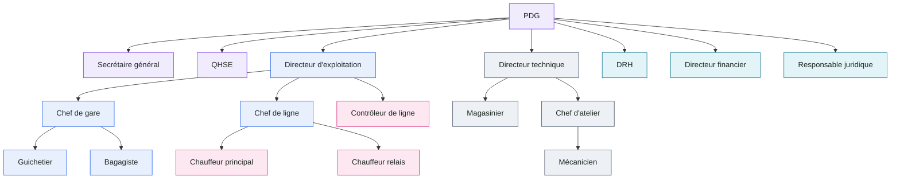

# Pôles et hiérarchie — analyse du 3 novembre 2026

Ce rapport décrit comment l'application organise une compagnie de transport : ses **cinq pôles**, la **chaîne hiérarchique**
(qui règle qui), les **décisions** qui passent d'un pôle à l'autre et les **relations de travail** entre pôles. Tout est tiré du
code lui-même (`communication/poles.py`, `configuration/regles.py`, le guide `communication/guides.py`, les alertes du serveur) :
c'est ce que l'application applique, pas une intention.

## En bref

- **18 postes en 5 pôles**, chacun avec sa couleur dans l'interface. Une seule ligne de commandement : chaque poste a **un
  supérieur direct** (le PDG pouvant en plus régler tout poste), sur **trois niveaux au plus** sous le PDG.
- **Pôle et hiérarchie ne se superposent pas** : le Personnel roulant n'a pas de responsable dans son pôle (les chauffeurs
  relèvent du chef de ligne, le contrôleur du directeur d'exploitation) ; les Fonctions supports et le QHSE relèvent directement
  du PDG.
- Trois choix d'organisation sont de **bonnes pratiques** : le magasin séparé de l'atelier, le contrôleur indépendant des chefs
  de ligne, le QHSE indépendant de l'exploitation et du technique.
- Les relations de travail se concentrent sur **Exploitation ↔ Personnel roulant** (28 passages de relais) ; le lien
  **Exploitation ↔ Technique** est le plus mince (2), et le **Personnel roulant n'a aucun lien direct avec les Fonctions
  supports**.
- **Sept points d'attention** (H-01 à H-07), **décidés** le 3 novembre (OR-01 à OR-07, §7) et placés au plan. Une précision du
  guide a été faite au passage (le congé qui touche des départs).

## 1. Les cinq pôles

| Pôle | Couleur | Postes | Responsable dans le pôle |
|---|---|---|---|
| **Direction Générale** | violet | PDG, secrétaire général, QHSE | le PDG |
| **Exploitation & Réseau** | bleu | directeur d'exploitation, chef de gare, chef de ligne, guichetier, bagagiste | le directeur d'exploitation |
| **Personnel roulant** | framboise | chauffeur principal, chauffeur relais, contrôleur de ligne | *aucun* : relève de l'Exploitation |
| **Technique & Maintenance** | gris acier | directeur technique, magasinier, chef d'atelier, mécanicien | le directeur technique |
| **Fonctions supports** | bleu canard | DRH, directeur financier, responsable juridique | *aucun* : chacun relève du PDG |

L'opérateur de la plateforme (superadmin) est hors des compagnies : il voit toutes les compagnies, n'en dirige aucune.

## 2. La chaîne hiérarchique : qui règle qui

Chaque échelon règle les postes placés directement sous lui (automatisation, jeu, mode vocal, durée de session, fonctions
retirées), toujours dans le cadre fixé par le PDG. Le PDG peut en plus régler **n'importe quel poste**.

```
PDG  (Direction Générale)
├── Secrétaire général ............ Direction Générale
├── QHSE .......................... Direction Générale
├── Directeur d'exploitation ...... Exploitation & Réseau
│   ├── Chef de gare .............. Exploitation & Réseau
│   │   ├── Guichetier ............ Exploitation & Réseau
│   │   └── Bagagiste ............. Exploitation & Réseau
│   ├── Chef de ligne ............. Exploitation & Réseau
│   │   ├── Chauffeur principal ... Personnel roulant
│   │   └── Chauffeur relais ...... Personnel roulant
│   └── Contrôleur de ligne ....... Personnel roulant
├── Directeur technique ........... Technique & Maintenance
│   ├── Magasinier ................ Technique & Maintenance
│   └── Chef d'atelier ............ Technique & Maintenance
│       └── Mécanicien ............ Technique & Maintenance
├── DRH ........................... Fonctions supports
├── Directeur financier ........... Fonctions supports
└── Responsable juridique ......... Fonctions supports
```



**Ce que montre l'arbre**

| Constat | Lecture |
|---|---|
| Unité de commandement | Chaque poste a un seul supérieur direct : pas de double rattachement, pas d'ordres contradictoires. |
| Profondeur | Trois niveaux sous le PDG au plus (PDG → directeur d'exploitation → chef de gare → guichetier). |
| Largeur | Sept postes rattachés directement au PDG : c'est beaucoup pour une seule personne (voir H-07). |
| Secrétaire général | État-major du PDG : il lit tout ce que lit la direction, ne règle aucun poste. |
| Pouvoir du PDG | Il peut régler tout poste, au-dessus de la chaîne : c'est voulu (« pouvoirs d'intervention directe »). |

## 3. Pôle et hiérarchie ne se superposent pas

| Poste | Son pôle | Son supérieur direct | Pôle du supérieur |
|---|---|---|---|
| Chauffeur principal, chauffeur relais | Personnel roulant | Chef de ligne | **Exploitation** |
| Contrôleur de ligne | Personnel roulant | Directeur d'exploitation | **Exploitation** |
| QHSE | Direction Générale | PDG | Direction Générale |
| DRH, directeur financier, responsable juridique | Fonctions supports | PDG | **Direction Générale** |
| Tous les autres | (le même que leur supérieur) | | |

Le **pôle** sert à adresser (notes de service, modèles juridiques, couleur de l'interface, guide) ; la **hiérarchie** sert à
régler et à décider. Pour le Personnel roulant, les deux divergent : c'est conforme à la pratique du secteur (l'exploitation
dirige les conducteurs), mais cela a une conséquence pratique (H-01).

## 4. Les décisions qui traversent les pôles

| Décision | Qui la demande | Qui décide | Qui est prévenu |
|---|---|---|---|
| Investissement (achat de cars, ouverture de ligne) | Directeurs d'exploitation, technique, financier | **PDG** | Le demandeur, de la décision |
| Fermeture ou réouverture d'une ligne | Chef de gare, chef de ligne | **Directeur d'exploitation** (le PDG peut aussi geler directement) | Le demandeur ; les gares concernées |
| Bloquer un car pour sécurité | — | **QHSE**, sur n'importe quel car | Chef d'atelier, directeur technique, chef de ligne, chef de gare |
| Remettre en service un car réparé | Atelier (clôture de l'ordre) | Atelier ; ou **QHSE** si le règlement intérieur l'exige | Chef de ligne, gares (ou le QHSE) |
| Congé | Tout agent | **DRH** | L'agent ; directeur d'exploitation et chef de ligne si des départs sont touchés |
| Compte du personnel (créer, modifier) | — | **PDG** ; le DRH si le règlement le permet | L'autre des deux |
| Suspendre un compte | — | **PDG** | DRH, chef de gare de l'agent |
| Annuler un ticket vendu | Guichetier | **Chef de gare** | (tracé au journal) |
| Pièce pour une réparation | Mécanicien, chef d'atelier | **Magasinier** (servir ou refuser) | Le demandeur |
| Note de service | — | **Secrétaire général**, PDG | Les postes des pôles visés |
| Règles du règlement intérieur | — | **PDG** (toutes) ; directeur technique (atelier, magasin) ; directeur d'exploitation (chauffeurs) | (tracé au journal) |

**Le règlement intérieur, pôle par pôle**

| Règle | Postes concernés | Décidée par | Défaut |
|---|---|---|---|
| Corriger ou annuler une sortie de pièce | magasinier, chef d'atelier, directeur technique | directeur technique, PDG | permis |
| Le mécanicien confie son ordre à un collègue | mécanicien | directeur technique, PDG | permis |
| Le mécanicien supprime son ordre | mécanicien | directeur technique, PDG | permis |
| Le chauffeur supprime sa feuille de route | chauffeurs | directeur d'exploitation, PDG | permis |
| Le chauffeur supprime un incident déclaré | chauffeurs | directeur d'exploitation, PDG | permis |
| Le DRH gère les comptes du personnel | DRH | PDG | non permis |
| La réparation remet en service un car bloqué par le QHSE | atelier, directeur technique | PDG | permis |

## 5. Les relations de travail entre pôles

Le guide décrit 112 gestes ; pour chacun, les postes avec qui il se coordonne (qui est prévenu, qui prend la suite), tous
vérifiés dans les deux sens par les tests. Compter ces passages de relais par pôle donne la carte des relations :

| De \ vers | Direction | Exploitation | Roulant | Technique | Supports |
|---|---|---|---|---|---|
| **Direction** | — | 5 | 6 | 5 | 10 |
| **Exploitation** | 5 | *21* | 13 | 1 | 2 |
| **Roulant** | 7 | 15 | *3* | 3 | 0 |
| **Technique** | 4 | 1 | 2 | *21* | 1 |
| **Supports** | 8 | 2 | 0 | 1 | *2* |

| Relation (deux sens) | Passages | Ce qui la porte |
|---|---|---|
| Exploitation ↔ Personnel roulant | **28** | Planification, feuille de route, temps de conduite, relais, incidents, colis à l'arrivée |
| Direction ↔ Fonctions supports | 18 | Investissements, comptes, synthèse RH et juridique, conformité, tutelle |
| Direction ↔ Personnel roulant | 13 | QHSE : défauts de checklist, incidents ; PDG : infractions graves au contrôle |
| Direction ↔ Exploitation | 10 | Investissements, billetterie, règlement, blocages de sécurité |
| Direction ↔ Technique | 9 | Investissements, règlement, blocages et levées du QHSE |
| Personnel roulant ↔ Technique | 5 | Défauts de checklist, pannes, défauts à la reprise |
| Exploitation ↔ Fonctions supports | 4 | Congés qui touchent des départs, import des ventes |
| Exploitation ↔ Technique | **2** | Seulement le chef de ligne et le chef d'atelier (retour estimé d'un car) |
| Fonctions supports ↔ Technique | 2 | Assurances (juridique et directeur technique) |
| Personnel roulant ↔ Fonctions supports | **0** | — |

**Lecture** : le **QHSE** est le pôle de liaison (il touche tous les autres) ; la **Technique** travaille surtout en interne ;
la coordination Technique ↔ Exploitation ne passe que par deux chefs, jamais par les deux directeurs.

## 6. Ce qui est bien construit

- **Séparation des tâches au technique** : le magasinier relève du directeur technique, pas du chef d'atelier qui consomme les
  pièces ; celui qui garde le stock n'est pas celui qui s'en sert (contrôle interne).
- **Contrôle indépendant** : le contrôleur de ligne relève du directeur d'exploitation, pas du chef de ligne dont il contrôle
  les conducteurs.
- **Sécurité indépendante** : le QHSE relève du PDG et peut bloquer un car de n'importe quel pôle.
- **Décisions remontées à un seul décideur** : investissements au PDG, fermetures de ligne au directeur d'exploitation, congés
  au DRH, pièces au magasinier ; le demandeur est toujours informé de la décision.
- **Réglages encadrés** : chaque échelon règle ses subordonnés directs, jamais au-delà du cadre de la compagnie ; le
  règlement intérieur dit qui décide de chaque règle.
- **Cloisonnement** : aucune de ces relations ne traverse une compagnie.

## 7. Points d'attention, et leur décision

Chaque point H-0n a reçu sa décision OR-0n le 3 novembre (détail dans
[ORGANISATION_COMPAGNIE_PLATEFORME_2026-11-03.md](ORGANISATION_COMPAGNIE_PLATEFORME_2026-11-03.md), §10) : OR-01 copie des notes à
l'encadrement, au choix de la compagnie ; OR-02 avis du supérieur sur un congé (ignorer, demander, exiger) ; OR-03 règle O-10 par
accord du directeur technique et du QHSE, le PDG informé ; OR-04 alertes croisées exploitation–technique, coupées par défaut ;
OR-05 budget carburant dépassé : directeur d'exploitation et chef de ligne prévenus ; OR-06 fusionné avec R-06 (chef de ligne
prévenu, planification ignorer / alerter / bloquer) ; OR-07 délégations du PDG, alertes critiques seules et synthèse du jour,
rattachement des supports au secrétaire général en option.

Les constats d'origine :

| # | Constat | Proposition |
|---|---|---|
| H-01 | Une note de service adressée au pôle « Personnel roulant » atteint les chauffeurs et le contrôleur, **pas leur encadrement** (chef de ligne, directeur d'exploitation), qui est dans un autre pôle | Ajouter, au choix de la compagnie, l'encadrement hiérarchique des postes visés aux destinataires d'une note |
| H-02 | Un congé est décidé par le DRH **sans l'avis du supérieur direct** ; le chef de ligne et le directeur d'exploitation ne sont prévenus qu'après, et seulement si des départs sont touchés | Avis du supérieur direct avant la décision, au choix de la compagnie : ignorer (comme aujourd'hui) / demander l'avis / exiger l'avis |
| H-03 | La règle de sécurité « levée du QHSE exigée » (O-10) est décidée par le **PDG seul**, alors que le QHSE porte la sécurité | La confier au QHSE et au PDG (le QHSE aurait alors l'écran du règlement intérieur pour cette règle) |
| H-04 | **Exploitation ↔ Technique** : les deux directeurs n'ont aucun geste commun ; la disponibilité de la flotte, l'ordre des réparations et les pénuries de cars se croisent sans se parler | Prévenir le directeur d'exploitation quand la disponibilité de la flotte passe sous un seuil réglable, et le directeur technique d'une pénurie de cars (lot P2, réglages) |
| H-05 | Le dépassement du **budget carburant d'une ligne** ne prévient que le directeur financier et le PDG, pas ceux qui font rouler la ligne | Prévenir aussi le directeur d'exploitation et le chef de ligne |
| H-06 | Un permis ou une visite médicale **expiré** prévient l'agent, le DRH et le QHSE, **pas le chef de ligne** qui planifie le conducteur ; rien n'empêche de le planifier | Prévenir le supérieur direct ; la réglementation au choix de la compagnie : ignorer / alerter à la planification / bloquer la planification |
| H-07 | **Sept postes** relèvent directement du PDG, et deux pôles (roulant, supports) n'ont pas de responsable propre | Pas de changement de code proposé ; à voir avec l'organisation réelle des compagnies (un directeur administratif et financier qui coifferait les supports, par exemple) |

Remarque technique : le rangement des postes par pôle existe en trois endroits (serveur, site, mobile). Le site est vérifié
contre le serveur par un test ; le mobile ne l'est que pour lui-même. Un test de plus, ou la lecture du rangement par l'API,
fermerait cet écart.

## 8. Fait au passage

Le guide disait le congé décidé par le DRH sans dire qui en est prévenu : il cite maintenant le directeur d'exploitation et le
chef de ligne (et ceux-ci le DRH), ce que le serveur fait déjà. Vérifié par les tests du guide (53 réussis), dont celui qui
exige que tout passage de relais soit décrit des deux côtés.
